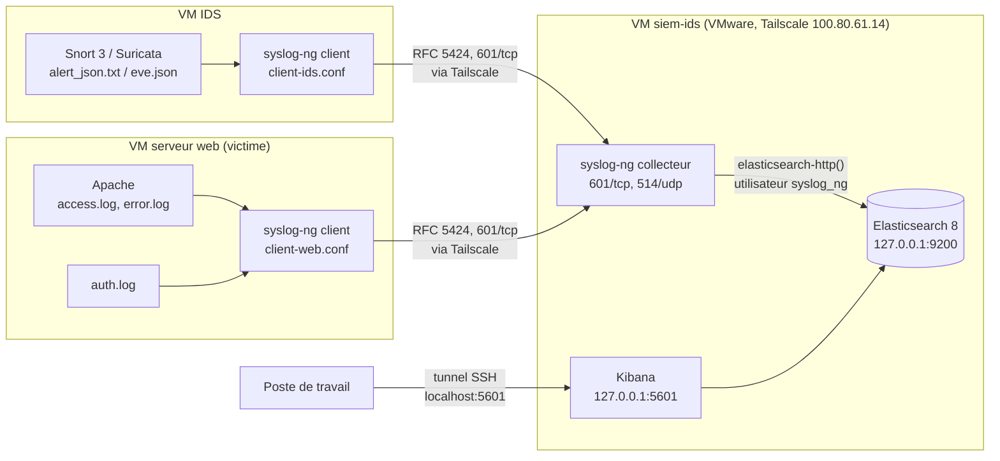

# Architecture

## Flux

| Source            | Transport               | Destination            | Index                  |
|-------------------|-------------------------|------------------------|------------------------|
| alertes Snort 3 / Suricata | syslog TCP 601 (Tailscale) | collecteur syslog-ng | `ids-alerts-%Y.%m.%d` |
| Apache access/error | syslog TCP 601 (Tailscale) | collecteur syslog-ng | `web-%Y.%m.%d`       |
| auth.log, autres  | syslog TCP 601 ou UDP 514 | collecteur syslog-ng | `syslog-%Y.%m.%d`      |
| collecteur        | HTTP `_bulk` sur 127.0.0.1:9200 | Elasticsearch | |

## Réseau

- La VM `siem-ids` tourne sous VMware (interface `ens33`, `172.16.24.110`) et a Tailscale installé directement. Les clients envoient à son IP Tailscale `100.80.61.14`, sans redirection de ports.
- Seuls 22/tcp (SSH), 601/tcp et 514/udp (syslog) écoutent sur les interfaces réseau.
- Elasticsearch et Kibana ne sont publiés que sur `127.0.0.1`. Kibana s'utilise depuis un tunnel SSH.
- Aucun pare-feu n'est configuré pour l'instant.
